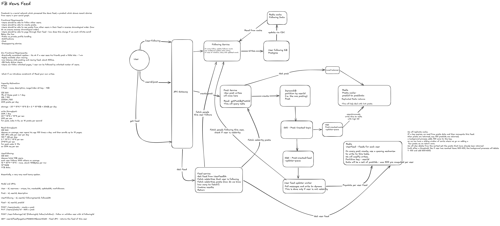

# Designing a Chronological News Feed — From My First Attempt to the Details

*My diagram already pushed ordinary posts and pulled celebrity posts. The harder questions were what happens to heavy readers, late posts, and the IDs I wanted to delete after scrolling.*

## Table of Contents

- [My Starting Design](#my-starting-design)
- [Where My Capacity Math Went Wrong](#where-my-capacity-math-went-wrong)
- [Why Push Ordinary Posts and Pull Celebrity Posts](#why-push-ordinary-posts-and-pull-celebrity-posts)
- [What If I Follow Thousands of Celebrities](#what-if-i-follow-thousands-of-celebrities)
- [How Many Celebrity Posts Do I Fetch](#how-many-celebrity-posts-do-i-fetch)
- [Ordering and Cursor Pagination](#ordering-and-cursor-pagination)
- [What Happens When a Post Arrives Late](#what-happens-when-a-post-arrives-late)
- [Will I See the Same Posts When I Reopen the App](#will-i-see-the-same-posts-when-i-reopen-the-app)
- [Why Deleting Read IDs Is Not Enough](#why-deleting-read-ids-is-not-enough)
- [Google Has Page Numbers So Why Use Cursors](#google-has-page-numbers-so-why-use-cursors)
- [Making the Event Pipeline Recoverable](#making-the-event-pipeline-recoverable)
- [Race Conditions and Failure Modes](#race-conditions-and-failure-modes)
- [The Complete Design](#the-complete-design)
- [Nuances and Debate](#nuances-and-debate)
- [Patterns to Carry Forward](#patterns-to-carry-forward)
- [Sources](#sources)

## My Starting Design



*Open the image at full size, or [open my original Excalidraw diagram](https://excalidraw.com/#json=UW2kFQocqH74E1ksoApxX,YkwBELHMMgJRopcmEdt7xw). The image is a 2x PNG export of the drawing.*

I chose a **chronological feed**: posts from followed accounts, newest first. Personalized ranking, media delivery, notifications, and private-profile rules stayed outside the session. This is an interview design, not a description of Facebook's production architecture.

My starting requirements were creating posts, following people, and paging through a feed. I allowed roughly one minute for another person's post to appear and targeted reads and writes below 500 milliseconds during normal operation. Unlimited follows and followers were deliberately challenging requirements; they do not make unlimited per-request work compatible with a fixed latency target.

The diagram had a Following Service backed by PostgreSQL and Redis, a Post Service backed by author-partitioned DynamoDB, and separate queues for warming post objects and updating follower feeds. The Feed Service combined a precomputed ordinary-author feed with posts fetched from followed celebrities. I proposed keeping about 500 post IDs per reader.

> **Redis** is an in-memory data store used here for disposable caches. **DynamoDB** is a managed key-value/document database whose keys must match the queries I need.

### What I got right

- **Post objects and feed references were separate.** One authoritative post could be referenced by many feeds.
- **Follower delivery happened in background workers.** Creating a post did not wait for every recipient.
- **Celebrities followed a different path.** Their posts were fetched during reads instead of copied to every follower.
- **The cache was bounded.** Keeping every historical reference in memory was never the plan.

### What the design was missing

- A precise ordering key and a continuation mechanism that survives new insertions.
- A mechanism for merging celebrity timelines and deciding how much to fetch.
- A policy for readers who follow an enormous number of celebrities.
- A durable connection between committing a post and scheduling delivery.
- A clear distinction between feed-cache contents, scrolling position, and viewed posts.
- A recovery story for cache loss, queue lag, and delayed delivery.

My worker label also said DynamoDB while the feed box said Redis. For this design I resolved that ambiguity: **the per-reader feed is a rebuildable Redis cache; posts and relationships are durable.**

> **Interview line:** "I precompute ordinary posts and merge celebrity timelines at read time. The feed cache is derived state; posts and relationships remain the source of truth."

## Where My Capacity Math Went Wrong

Every number below is an **illustrative scenario assumption**, not a current Facebook statistic. I assumed 2 billion daily active users, 1% posting once per day, 1 KB per post excluding media, and 100 total feed-page requests per active user per day. Storage uses decimal units: 1 KB = 1,000 bytes.

| Quantity | Calculation | Result |
|---|---|---|
| Posts per day | 2 billion × 1% | 20 million |
| Average post writes | 20 million / 86,400 | About 231/second |
| Peak post writes, assumed 5x | 231.48 × 5 | About 1,157/second |
| Raw post storage | 20 million × 1 KB | 20 GB/day |
| Average feed requests | 2 billion × 100 / 86,400 | About 2.31 million/second |
| Peak feed requests, assumed 10x | Average × 10 | About 23.1 million/second |
| Follow edges, assuming 10 billion total users | 10 billion × 1,000 follows | 10 trillion edges |
| Raw edge storage, assumed 100 bytes each | 10 trillion × 100 bytes | **1 PB** |

I had called the last number 1 TB. It is 1 PB, before indexes, reverse lookups, and replicas. A replica is an additional copy of data maintained on another server or region.

My notes also mixed "100 app opens, each scrolling 10 pages" with "100 API calls per day." The first implies about 1,000 page requests, making average traffic 23.1 million requests/second. I chose 100 total requests for the rest of the design; I cannot use both estimates interchangeably.

The missing multiplier was delivery:

> **Fan-out** means expanding one event into work for many recipients. **Write amplification** is the extra physical writing caused by one logical write.

With an assumed average of 1,000 recipient updates per post:

```text
20 million posts/day × 1,000 recipients = 20 billion feed insertions/day
20 billion / 86,400 ≈ 231,000 insertions/second
```

That is before limiting delivery to active readers or excluding celebrities. The average must be weighted by who posts: average follows per account does not establish average recipients per post.

Connections are another quantity. An open app need not issue a feed request each second, and this feed API does not require a persistent connection. Request traffic sizes the feed services; idle connection counts are a separate gateway concern.

> **Interview line:** "I size post creation, feed reads, and recipient updates separately. A small post-write rate can hide a much larger fan-out workload."

## Why Push Ordinary Posts and Pull Celebrity Posts

The simplest feed stores posts by author and reads recent posts from every followed author whenever I open the feed. With 1,000 follows and 2.31 million feed requests/second, that is roughly 2.31 billion logical author lookups/second. Batching can reduce network calls; the underlying retrieval work still exists.

The opposite approach prepares every follower's feed as soon as an author posts. Reads become cheap, but a celebrity with an assumed 100 million followers creates 100 million recipient updates. At an illustrative sustained worker capacity of 200,000 updates/second, that is 500 seconds of capacity for one post, before competing work.

| Approach | Benefit | Cost |
|---|---|---|
| Pull everything on read | One post write; no reader-specific duplication | Repeated work proportional to followed sources |
| Push everything on write | Reads use a prepared list | Large recipient bursts and work for inactive readers |
| Hybrid | Prepared ordinary feed plus celebrity timelines | More complicated reads, policy, and transitions |

"Celebrity" is a policy shortcut. The economic question is whether maintaining recipient references costs less than repeatedly fetching the author's timeline. Follower count, reader activity, and posting frequency all matter.

I keep recent feed references separate from cached post objects. Updating a post should not require rewriting its body in every follower's cache. Reading a page retrieves the references, then fetches objects in batches and filters deleted or ineligible posts.

> **Interview line:** "I trade writes for cheap repeated reads, but avoid copying every celebrity post to every follower. The policy follows workload costs rather than a universal follower threshold."

## What If I Follow Thousands of Celebrities

This was my first follow-up question. The ordinary-author list is already combined, but celebrity reads still scale with the number of followed celebrity sources. A heap makes combining the results efficient; it cannot remove the cost of opening those sources.

Suppose I follow 3,000 celebrities and request 20 posts. Fetching 20 references from each yields 60,000 candidates. Fetching just one from each still requires 3,000 logical lookups. At 100 concurrent requests and an assumed 10 milliseconds per lookup, 30 waves alone take about 300 milliseconds, excluding other work and slow responses.

I considered three approaches:

| Approach | What improves | Remaining problem |
|---|---|---|
| Cache and batch celebrity reads | Lower lookup cost and network overhead | Source count still grows with follows |
| Build a session list on opening | Reuse work across scrolling pages | Expensive initial build and refresh |
| Maintain a combined feed for selected readers | Cheap repeated reads | Additional writes, storage, and subscription state |

For active readers with very many celebrity follows, I would selectively push celebrity posts into their combined feed too. A celebrity with 100 million followers might have only an illustrative 20,000 active heavy readers needing this treatment. Writing to those 20,000 is a different workload from writing to all 100 million.

The worker needs an index of selected recipients, rather than scanning every follower to find them:

```python
def schedule_delivery(post):
    if author_uses_pull_by_default(post.author_id):
        recipients = active_heavy_followers(post.author_id)
    else:
        recipients = active_followers(post.author_id)
    for batch in chunks(recipients, 500):
        enqueue_insertions(post.reference, batch)
```

The model gains `ViewerFeedPolicy` and `ActiveHeavyFollowersByAuthor`; existing post and relationship records remain. Active heavy readers use the maintained combined list, ordinary readers merge celebrity sources, and inactive readers avoid accumulating hot feed caches. Switching modes requires backfill and overlapping delivery before the previous path is removed.

Compare costs over the same interval:

```text
Pull cost ≈ fresh retrievals × celebrity sources × lookup cost
Push cost ≈ relevant posts × recipient insertion cost
```

Materialization does not make a returning user's first rebuild free. Nor does it make an arbitrarily prolific subscription set cheap. I need bounded work, queue capacity, and an explicit cold-start experience when normal latency is impossible.

Fetching only the "most important" 100 celebrities would change the chronological-feed requirement. An ignored author might own the newest post. Skipping a source safely needs reliable information proving it cannot contribute, or a weaker completeness promise.

> **Interview line:** "Delivery mode depends on the reader as well as the author. I selectively maintain celebrity references for active heavy readers, while ordinary readers continue to pull celebrity timelines."

## How Many Celebrity Posts Do I Fetch

If the page size is 20, fetching the newest 20 distinct, eligible posts from **each complete source** is sufficient to find the global newest 20. The 21st post in one source already has 20 newer posts ahead of it in that source alone.

That is a correctness bound, not an efficient fetching policy. I can use small prefetched batches and refill the sources I consume.

> **K-way merge** combines several sorted lists into one sorted result. A **max-heap** keeps the largest current candidate available without comparing every source again for every output item.

For a three-item page:

```text
Ordinary feed:  10:05 A, 10:02 D, 09:58 G
Celebrity X:   10:06 B, 10:01 E, 09:55 H
Celebrity Y:   10:04 C, 10:03 F, 09:50 I

Output:        10:06 B, 10:05 A, 10:04 C
```

Every source is sorted, so its next item bounds everything behind it. After choosing B, only X's head advances. After choosing A, only the ordinary list advances.

```python
heap, page, emitted = MaxHeap(), [], set()
for source in sources:
    if item := source.next():
        heap.push(item.order_key, item, source)
while heap and len(page) < limit:
    _, item, source = heap.pop()
    if item.post_id not in emitted and eligible(item):
        page.append(item)
        emitted.add(item.post_id)
    if next_item := source.next():
        heap.push(next_item.order_key, next_item, source)
```

`next()` consumes a buffered batch, refilling when necessary. Post-object lookup and eligibility checks should also use batches. Deleted posts and duplicated references mean I may inspect more than 20 raw candidates to return 20 usable posts. If sources fail, I cannot claim a complete newest page from the surviving sources.

> **Interview line:** "Each sorted source contributes its next candidate to a max-heap. I advance the winning source, refill in batches, and keep merging until I have enough distinct eligible posts or exhaust the sources."

## Ordering and Cursor Pagination

My diagram asked how to guarantee reverse chronological order. The answer needs an immutable key:

```text
(server_created_at_ms, post_id), descending
```

The unique ID breaks timestamp ties. The server assigns creation time; worker processing time and phone clocks do not decide placement. Distributed server clocks can disagree, so this is a deterministic service-defined chronology, not proof of the exact real-world order of simultaneous events.

> A **Redis sorted set** stores unique members ordered by a numeric score, with bytewise member ordering breaking score ties.

I can use millisecond creation time as score and a fixed-width post-ID encoding as the leading member field. The same post always uses the same member, carrying its complete lookup reference. Equal-timestamp reads must apply the ID boundary too; excluding the entire timestamp would skip other posts from that millisecond.

[Redis documents](https://redis.io/docs/latest/commands/zadd/) that integer scores are represented exactly through ±2^53. Current millisecond timestamps fit; arbitrary 64-bit post IDs may not. I should not cast a large ID into the score and assume its order survives.

My original API used `pageNum`. Offsets shift when the list changes:

```text
Initial:                 105, 104, 103, 102, 101, 100
Page 1, size 3:          105, 104, 103
106 arrives:             106, 105, 104, 103, 102, 101, 100
Offset 3, next page:      103, 102, 101  ← repeated 103
```

> **Cursor pagination** continues from a stable ordering boundary rather than skipping a numerical count of current entries.

I replace the page number with `GET /me/feed?limit=20&cursor=...`. The validated token contains the last returned creation key and the first request's upper bound. The server obtains the viewer from authentication and applies the same bounds to every source.

```python
def read_page(viewer, token, limit):
    bounds = validate_cursor(token, viewer) if token else initial_bounds()
    sources = open_sources(viewer, upper=bounds.upper, before=bounds.before)
    page = merge_eligible(sources, limit)
    if not page:
        return [], None
    next_token = encode_cursor(viewer, bounds.upper, page[-1].order_key)
    return page, next_token
```

An implementation may look ahead to avoid returning a cursor for the final page; an empty continuation page is also possible. Infinite scroll uses the same API and automatically requests the next page near the screen's bottom. It does not require a different storage model.

> **Interview line:** "I use an immutable timestamp-and-ID order and apply one cursor boundary across all sources. New posts cannot shift the position of the next older page."

## What Happens When a Post Arrives Late

I asked what happens when an older post is added after the reader has already seen newer items. The precise answer depends on whether the reader has passed its position.

Suppose page one returns A at 12:10, B at 12:08, and C at 12:06. The continuation boundary is `(12:06, C)`.

| Delayed post | When it becomes available | Outcome |
|---|---|---|
| D at 12:05 | Before page two | Eligible for page two |
| D at 12:07 | Before page two | Above the cursor; continuation misses it |
| D at 12:05 | After page two advances to 12:02 | Its position has now been passed |

The first case works normally: late arrival changes when the post is available, not its creation order. In the other cases a refresh from the top can reveal it, assuming it remains eligible and within the retrieved history.

This corrected an ambiguity in my wording. A cursor is a **pagination boundary**, not a certificate that I saw every post newer than that boundary.

The first request's upper bound excludes posts created after that bound. It does not freeze the arrival of older posts. A **snapshot** is a fixed view of membership or data state; timestamp bounds alone are not one.

If I promise a fixed scroll session, I can materialize a session-specific result list, but it freezes whatever candidates were known when built. To include every committed eligible post before a cutoff, I additionally need evidence that delivery or authoritative retrieval covers that cutoff. Freezing an incomplete cache does not repair it.

For the original eventual-consistency requirement, I accept refresh-based discovery of delayed posts above the cursor. I would state that guarantee explicitly rather than promise every post exactly once during a scroll.

> **Interview line:** "A late post appears if it arrives before I pass its creation position. Cursor pagination preserves order, but asynchronous arrival means a refresh may be necessary to discover posts above the current boundary."

## Will I See the Same Posts When I Reopen the App

My next question was whether I would see the same 20 posts after closing and reopening, assuming followed authors had not posted anything new.

For a fresh newest-first request, **yes**, assuming no edits, deletions, relationship changes, or newly delivered older posts change the result. A chronological feed does not imply unseen-only delivery.

| Desired behavior | State required |
|---|---|
| Start from the newest posts | No saved scrolling position |
| Resume where I stopped | Saved cursor and possibly visible-item position |
| Show only posts I have not seen | Persistent per-user seen records |

A product can restore the previous screen and offer a refresh action that returns to the top. That is a client experience decision, independent of whether the shared feed cache still holds A through T.

> **Interview line:** "Reopening can restart at the top or restore a saved cursor. Showing only unseen posts is an additional requirement with its own persistent state."

## Why Deleting Read IDs Is Not Enough

My initial idea was a sliding window: after returning items 300–400, delete items 1–100 and add 500–600. That mixed cache capacity with consumption. The correction is more precise than saying deletion is always bad: **deletion can support an unread queue, but it cannot casually substitute for a durable consumption protocol.**

Consider returning A, B, and C, then deleting their references:

1. **The user may never see them.** The response can be lost, or the client can prefetch a page the user never scrolls into.
2. **Another device shares the changed cache.** A phone reading A–C causes the laptop to start at D, even if independent browsing was intended.
3. **A rebuild forgets consumption.** Redis expires, the feed rebuilds from author timelines, and A–C return.
4. **Retried fan-out reinserts them.** Inserting the same existing member is harmless; inserting it after deletion creates it again.

Waiting for client acknowledgment solves part of the first problem, but now I am explicitly designing consumption tracking. Account-wide consumption might intentionally affect every device. That behavior must survive rebuilds and retries, so the cache cannot be its only record.

I keep these states separate:

| State | Meaning | Example |
|---|---|---|
| Feed cache | Recent candidate references | A, B, C, D, E |
| Cursor | Position in one traversal | Before `(12:06, C)` |
| Seen state, if required | Posts actually viewed | User U saw A and B |

An **impression** records that a post was displayed according to a chosen viewing rule. Receiving an API response is not necessarily an impression. If unseen-only behavior is required, the client reports impressions and the server records `(user_id, post_id, seen_at)` independently of feed-cache retention.

The read path checks candidate IDs against seen state in batches and continues until the page fills or its work budget is reached. A single timestamp is insufficient: a post created yesterday but delivered today may still be unseen. Persistent seen records also have storage, retention, and consistency costs; retention limits weaken any promise of never repeating a post.

For the ordinary chronological feed, I trim the newest-reference cache by size or age, expire inactive readers, and clean up deleted or ineligible posts. Scrolling does not consume the shared list. Deeper history comes from authoritative author timelines when the cursor falls beyond cached coverage.

At 2 billion users and 500 entries each, that would be 1 trillion cached references. Even a hypothetical 16-byte reference is 16 TB before keys, overhead, and replicas. The full lookup references in this design can be larger. This supports caching active readers rather than allocating 500 entries for every account.

An extremely old late post may fall outside the newest 500 immediately. Its durable author timeline still retains it; the historical-read path can find it.

> **Interview line:** "Candidates, browsing position, and viewing history are different state. I bound the shared feed cache by recency and capacity, and persist consumption separately if the product requires unseen-only results."

## Google Has Page Numbers So Why Use Cursors

I challenged cursor pagination because Google shows numbered result pages. The missing distinction was between what the interface displays, what the request specifies, and how the backend retrieves results.

| Layer | Examples |
|---|---|
| Interface | Numbered pages, Next, infinite scroll |
| Request | `page=3`, `start=20`, continuation token |
| Retrieval | Re-execute search, slice cached IDs, continue after a sort boundary |

Google's [Custom Search JSON API](https://developers.google.com/custom-search/v1/reference/rest/v1/cse/list) documents a positional `start` parameter: with the default 10 results, `start=11` begins page two. It caps returned results at 100. This source establishes that API's contract; it does not reveal the consumer Google Search website's internal pagination implementation. Documentation was checked during article preparation on November 5, 2026.

A service could compute and cache 100 result IDs, then slice them by page number. It could also remember cursor boundaries for visited pages. Neither requires an expensive database offset on every click. These are possible designs, not claims about Google's internals.

Numbered pages are reasonable for bounded results and direct page jumps. Our feed mostly needs sequential continuation through a changing chronological list. Jumping directly to an unseen page with cursors needs a known boundary or additional positional state.

[Elasticsearch documents](https://www.elastic.co/docs/reference/elasticsearch/rest-apis/paginate-search-results) the cost of deep `from`/`size` pagination: shards retain candidates for preceding pages too. Its `search_after` mechanism continues using prior sort values; its point-in-time view separately preserves index state. That is the same distinction we encountered between a feed cursor and a snapshot.

> **Interview line:** "Page numbers do not prove database offsets. Cursors fit sequential feed traversal, while stable session membership requires separate snapshot state."

## Making the Event Pipeline Recoverable

My diagram had an arrow from the post database to an event topic. The arrow hid a failure: commit the post, crash before publishing, and no worker learns about it.

> **Change data capture (CDC)** reads committed changes from a database change log. **SNS** distributes notifications to subscribers; **SQS** holds work messages for independently retrying workers.

For the chosen DynamoDB post store, I use DynamoDB Streams as the committed-change source. A consumer publishes to SNS and advances its processing checkpoint only after successful publication. Separate SQS queues feed the fan-out workers and optional post-cache warmers.

Publication can succeed just before a crash, causing the change to be published again after restart. Workers must tolerate duplicates.

> **Idempotency** means repeating an operation has the same final effect as doing it once. **At-least-once processing** allows retries, including duplicate attempts, so effects need that property.

Each post has a stable reference. Workers insert it into recipient sorted sets using the same member and creation score, then acknowledge completed work. Large follower lists are split into bounded batches with continuation/progress state. Cache insertion and trimming should be atomic for one reader so concurrent workers preserve the size bound.

[AWS documents](https://docs.aws.amazon.com/amazondynamodb/latest/developerguide/Streams.html) 24-hour DynamoDB Streams retention and ordering of changes to the same item. That does not imply global post order or exactly-once worker effects. Processing lag approaching retention is an incident; recovery beyond the retained log needs archived changes or a reconciliation scan of stored posts.

Kafka is another choice: a retained event log whose consumers track their own positions and can replay records. It can suit several independent replaying consumers. It does not eliminate duplicate effects or fan-out economics. SNS/SQS remains a reasonable choice for this design's retried jobs.

Post objects use demand caching, with optional asynchronous warming. A **TTL (time to live)** limits how long an entry stays cached. Version-aware writes stop a delayed old event from overwriting newer content. Deletions need a durable marker and an appropriate read-time check, rather than depending on a long TTL.

> **Interview line:** "I derive delivery work from committed changes and checkpoint after publication. Retries are expected, so recipient insertions and object-cache updates must tolerate duplicates and stale events."

## Race Conditions and Failure Modes

**Unfollow races with fan-out.** A worker captures followers, the reader unfollows, then the worker inserts the post. Removing references during unfollow does not stop that late write. The read path filters against current relationships; strict immediate removal requires sufficiently fresh relationship reads, not just a stale cached list.

**Follow races with reverse-index updates.** If the author-to-followers view lags, a post can miss a new follower. Follow processing must backfill recent posts and overlap with delivery, then deduplicate. Repairs or authoritative fallback cover gaps rather than assuming one asynchronous index update made both directions current.

**Deletion races with an old create event.** A versioned durable deletion marker prevents an old event from reviving content. Cache updates compare versions atomically. Immediate deletion visibility also needs sufficiently consistent status checks or a defined invalidation barrier; version comparison alone cannot fix a cache that has not heard about the deletion.

**Push/pull policy changes.** Stopping push before pull begins creates a gap. Overlap the paths, backfill recent references, and deduplicate by post ID. Moving to push requires proving the combined feed covers the range before removing pull fallback.

**Feed rebuild races with new fan-out.** Replacing the entire key with an old rebuild result can discard newly inserted references. Merge rebuilt references atomically with the current set and trim, or use a generation-and-catch-up protocol. Cache coverage metadata must correspond to what the rebuild actually completed.

**Follower counts become hot.** An atomic increment avoids a client read-modify-write retry loop, but one heavily written counter still has a limit. Approximate asynchronous counts may be sufficient for display and policy, provided duplicate events do not inflate them and policy transitions remain safe.

| Failure | Impact | Response |
|---|---|---|
| Feed-cache shard loss | A subset of readers lose prepared lists | Limit concurrent rebuilds and serve a documented cold path |
| Post-object cache loss | Many reads reach durable storage | Batch, rate-limit fallback, and shed work before overload |
| Queue lag | New posts appear late | Monitor oldest work age and end-to-end visibility delay |
| Celebrity source timeout | Newest complete page cannot be established | Retry or return an explicitly incomplete response; do not silently advance past an unknown source |
| Region failure | Caches and recent replicated data may be unavailable | Fail over according to durable replication guarantees and rebuild derived state |

Concurrent requests for one missing feed should share a rebuild. In one process that can be a shared future; across instances it needs coordination such as a short ownership lease. A lease gives temporary ownership that expires if the owner dies. It also needs concurrency limits across users so one cache outage does not overwhelm storage.

Regional feed caches can be rebuilt from replicated posts and relationships. Asynchronous cross-region replication can lag; failover does not automatically preserve recent read-your-own-writes guarantees.

> **Interview line:** "I expect stale work to race with current state. Eligibility checks, versioned objects, overlapping transitions, and bounded rebuilds keep derived caches from becoming the source of truth."

## The Complete Design

The system remains focused on feed generation. A gateway authenticates and routes requests to stateless services. There is no need to explain media delivery to defend this design.

```text
Create post
    |
Post Service ------> DynamoDB PostByAuthor
                            |
                      DynamoDB Streams
                            |
                      publishing worker
                            |
                         SNS topic
                       /           \
               Feed-work SQS    Cache-work SQS
                    |                |
              fan-out workers   version-aware warmers
                    |                |
              FeedCache         PostObjectCache

Read feed
    |
Feed Service <------ relationships + viewer delivery policy
    |--- FeedCache: ordinary posts, or maintained combined feed
    |--- celebrity timelines when the policy requires pull
    |--- viewer's own committed posts
    |--- author-history fallback beyond cache coverage
    |
common bounds -> sorted merge -> batch object fetch -> eligibility filters
    |
items + next cursor
```

### Data model and storage choices

> A **partition key (PK)** selects a logical partition; a **sort key (SK)** orders records inside it. **Sharding** spreads records across servers by key. A bucket bounds partition size or splits a large list into several partitions.

| Data | Choice for this design | Why |
|---|---|---|
| Profiles | PostgreSQL | Structured metadata with transactional updates |
| Relationships | Sharded PostgreSQL behind the Following Service | Direct lookups and adjacency lists; explicit reverse access |
| Author timelines | DynamoDB | Keyed writes and ordered per-author ranges |
| Feed references and post objects | Separate Redis caches | Different update patterns and shared object reuse |
| Optional seen records | Distributed durable key-value storage | Per-user, per-post membership checks |

One PostgreSQL instance is insufficient for the assumed relationship volume. A distributed key-value relationship store is also reasonable. A graph database is not required just to enumerate direct neighbors; complex multi-hop traversals would change that assessment. Cassandra is another timeline option, with a different operating and consistency model. These choices follow access patterns rather than a claim that one database category always wins.

The following are logical schemas, not vendor-specific table-creation syntax. For SQL relationships, PK/SK describe routing and index access, not literal DynamoDB keys. IDs are strings; creation timestamps are 64-bit millisecond integers; versions are increasing integers.

```text
User
  PK: user_id
  fields: username, created_at_ms

PostByAuthor
  PK: author_id + UTC_month_bucket
  SK: fixed_width(created_at_ms) + fixed_width(post_id)
  fields: body, media_reference?, version, deleted

FollowingByViewer
  PK: viewer_id + follow_bucket
  SK: author_id
  fields: followed_at_ms, relationship_version

FollowersByAuthor
  PK: author_id + follower_bucket
  SK: viewer_id
  fields: relationship_version

ViewerFeedPolicy
  PK: viewer_id
  fields: delivery_mode, active_until_ms, policy_version

ActiveHeavyFollowersByAuthor
  PK: author_id + follower_bucket
  SK: viewer_id
  fields: policy_version, active_until_ms

FeedCache [Redis, derived]
  key: viewer_id
  ordered members: full post references, newest 500
  metadata: rebuilt_at_ms, oldest_covered_key, truncated, policy_version

PostObjectCache [Redis, derived]
  key: complete post lookup key
  value: version, body, deleted

SeenPosts [optional product extension, durable]
  PK: viewer_id + seen_bucket
  SK: post_id
  fields: seen_at_ms

PostReference
  author_id, UTC_month_bucket, created_at_ms, post_id
```

Bucket functions must be deterministic and their layouts discoverable. Bucketing very large outgoing follow lists means enumeration spans buckets; it bounds partitions rather than eliminating the work. Author-month buckets similarly require moving into older months for history. No post-ID-only lookup index is required because references carry complete keys.

Coverage metadata distinguishes a usable cache range from a trimmed list. At its lower boundary, reads merge author-history sources under the same cursor instead of declaring end-of-feed. Cache bounds do not prove all asynchronous fan-out inside the range has arrived.

### API

```text
POST   /me/posts                         -> created post
PUT    /me/posts/{post_id}                -> edited post
DELETE /me/posts/{post_id}                -> deletion result
PUT    /me/following/{author_id}          -> follow result
DELETE /me/following/{author_id}          -> unfollow result
GET    /me/feed?limit=20&cursor=<token>   -> {items, next_cursor}
POST   /me/impressions                   -> optional seen-state acknowledgment
```

Requests are authenticated and enforce ownership on edits/deletes. Repeated follow/unfollow operations must not repeatedly adjust counts. For writes that do not carry a complete author key, the authenticated viewer provides author identity and the service resolves the time bucket from its stable post-ID format or an explicit lookup mapping.

### Ordinary post to reader

1. The Post Service validates the request, assigns the stable ID and creation time, and durably commits the post.
2. It returns the created object to the author without waiting for follower delivery.
3. The stream consumer publishes the committed change to SNS; independent queues receive work.
4. Fan-out workers enumerate the appropriate active recipients in batches, insert stable references, and trim caches atomically per reader.
5. The reader requests a page; the Feed Service merges policy-selected sources under common bounds, fetches objects in batches, filters, and returns a cursor.

### Author reads their own write

1. The client can immediately display the created object returned by the write.
2. For a fresh top-of-feed read, merge the viewer's own committed timeline with other sources and deduplicate. The new post appears when it belongs in the requested page; an older continuation cursor deliberately excludes newer posts.
3. Use a sufficiently consistent read in the write region. **Read-your-own-writes** means a successful write is reflected in subsequent reads that query its data or range; it does not force that post into every paginated response and is independent of follower fan-out completion.

[DynamoDB base tables support strongly consistent reads; global secondary indexes do not](https://docs.aws.amazon.com/amazondynamodb/latest/developerguide/HowItWorks.ReadConsistency.html). A global secondary index is an asynchronously maintained alternate-key index. Cross-region failover requires its own consistency policy.

### Reopen or return after inactivity

1. The client chooses a fresh top request or restores a saved cursor according to product behavior.
2. If the feed cache is present and covers the requested range, use it with the required pull sources.
3. If missing, coordinate one rebuild for that reader, with a limit on simultaneous rebuilds across readers.
4. Read authoritative timelines in bounded batches and merge them. A broad cold rebuild may exceed the normal 500-millisecond target; report/loading behavior must reflect that.
5. Merge rebuilt references with concurrent insertions rather than replacing them, record actual coverage, and continue older-history retrieval as needed.

### Worker crash and redelivery

1. A worker completes some recipient insertions and crashes before acknowledging its batch.
2. The queue makes the work available for retry according to its delivery policy.
3. The replacement worker repeats stable-member insertions; completed recipients do not accumulate duplicate references.
4. It acknowledges after the assigned batch succeeds. Persistent failures remain visible for repair instead of being silently discarded.

> **Interview line:** "The durable write finishes before delivery work. Reads combine prepared references and authoritative timelines, while retries and rebuilds preserve the same stable post identity and ordering key."

## Nuances and Debate

**Should feed references themselves be durable?** A durable reader inbox makes some recovery paths cheaper, but adds storage and recipient-write costs. I start with derived caches and authoritative history, then consider durable recent inboxes if cache recovery becomes the dominant problem.

**Should every account receive ongoing fan-out?** It simplifies cold reads, but spends work on inactive accounts. I maintain active readers and accept an explicit cold rebuild path; the activity window is an operational tuning choice.

**Should scrolling freeze results?** A session list gives stable membership among known candidates, but adds state and does not establish complete delivery before the cutoff. For this scenario, I accept discovering late posts on refresh.

**Should previously viewed posts disappear?** An unread product may require that behavior. A chronological feed does not. I keep the optional impression/seen model separate so cache eviction does not accidentally decide product semantics.

**Can source failures produce a partial page?** Availability favors returning something; complete chronological ordering requires knowing whether the failed source had newer items. I would expose incomplete status and retain a retryable boundary rather than silently advance a completeness claim.

> **Interview line:** "I make freshness, completeness, resume behavior, and unseen-only delivery separate promises. Each stronger promise needs state or coordination beyond a fast cache."

## Patterns to Carry Forward

- **Hybrid fan-out:** prepay repeated retrieval work selectively, based on both sender and reader workloads.
- **Sorted-source merge:** each source's head bounds its remaining items; a heap picks the next global item.
- **Cursor versus snapshot:** a stable boundary handles position; a snapshot handles membership, and completeness still needs adequate coverage.
- **Derived state versus product state:** rebuilding a cache must not erase viewing history or authoritative eligibility.
- **Durability before delivery:** use committed changes to drive retried asynchronous effects.
- **Idempotent, version-aware consumers:** duplicate or stale work must not duplicate references or revive deleted content.
- **Bounded rebuilds:** share same-user recovery work and protect authoritative stores during broad cache loss.

## Sources

External documentation was fetched during preparation on **November 5, 2026**. Company-scale figures throughout this article are hypothetical scenario inputs. The Google API statement is limited to the documented API, and no Facebook production-stack claim is intended.

- [Redis ZADD: unique members, tied scores, and integer precision](https://redis.io/docs/latest/commands/zadd/) — also checked against the [Redis documentation source](https://raw.githubusercontent.com/redis/redis-doc/master/commands/zadd.md).
- [DynamoDB Streams: committed changes, per-item ordering, and retention](https://docs.aws.amazon.com/amazondynamodb/latest/developerguide/Streams.html).
- [DynamoDB read consistency](https://docs.aws.amazon.com/amazondynamodb/latest/developerguide/HowItWorks.ReadConsistency.html).
- [SNS fan-out to SQS queues](https://docs.aws.amazon.com/sns/latest/dg/sns-sqs-as-subscriber.html).
- [SQS standard queues and at-least-once delivery](https://docs.aws.amazon.com/AWSSimpleQueueService/latest/SQSDeveloperGuide/standard-queues-at-least-once-delivery.html).
- [Kafka introduction: retained events and independent consumption](https://kafka.apache.org/intro).
- [Google Custom Search JSON API: list parameters](https://developers.google.com/custom-search/v1/reference/rest/v1/cse/list).
- [Elasticsearch pagination: offsets, search_after, and point-in-time views](https://www.elastic.co/docs/reference/elasticsearch/rest-apis/paginate-search-results).
- [HelloInterview's Facebook News Feed answer key](https://www.hellointerview.com/learn/system-design/answer-keys/fb-news-feed) — read as a tone and presentation reference, not as evidence of Facebook's production architecture.
