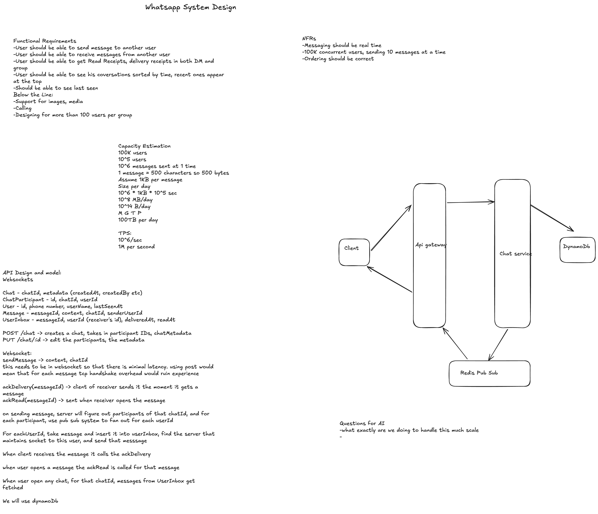

# Designing WhatsApp — From My First Attempt to the Real Thing

*I drew a WhatsApp design on Excalidraw before studying the real thing. Some of it was good. A lot of it was wrong. This is what I learned by chasing every gap.*

## Table of Contents

- [My Starting Design](#my-starting-design)
- [Where My Capacity Math Went Wrong](#where-my-capacity-math-went-wrong)
- [Transport: Why WebSockets Win](#transport-why-websockets-win)
- [Data Model and Database Selection](#data-model-and-database-selection)
- [The Core Hard Problem: Routing a Message to an Online Recipient](#the-core-hard-problem-routing-a-message-to-an-online-recipient)
- [Ordering: Why Clocks Can't Be Trusted](#ordering-why-clocks-cant-be-trusted)
- [Presence and Last-Seen at Scale](#presence-and-last-seen-at-scale)
- [Group Messaging and the Fan-Out Question](#group-messaging-and-the-fan-out-question)
- [How 2 Million Sockets Fit on One Machine](#how-2-million-sockets-fit-on-one-machine)
- [What Happens When a User Opens the App](#what-happens-when-a-user-opens-the-app)
- [What Happens When a Connection Server Dies](#what-happens-when-a-connection-server-dies)
- [The Thundering Herd and How Jitter Fixes It](#the-thundering-herd-and-how-jitter-fixes-it)
- [Group Read Receipts: The Tick Problem](#group-read-receipts-the-tick-problem)
- [Race Conditions: When Someone Joins Mid-Message](#race-conditions-when-someone-joins-mid-message)
- [Redis Pub/Sub vs Kafka: Making the Call](#redis-pubsub-vs-kafka-making-the-call)
- [The Complete Design](#the-complete-design)
- [Nuances and Debate](#nuances-and-debate)
- [Patterns to Carry Forward](#patterns-to-carry-forward)

---

## My Starting Design

Here's the design I drew before studying the real thing:



*Click the image to see it full size, or [open the interactive version on Excalidraw](https://tinyurl.com/3rw9nw2z).*

In text form, it came down to this:

**Functional requirements:**
- Send and receive messages between users
- Read receipts and delivery receipts in both DMs and groups
- Conversations sorted by time (recent on top)
- Last-seen visibility
- Below the line: media, calling, groups over 100 people

**Non-functional requirements:**
- Real-time messaging
- 100K concurrent users, each sending ~10 messages at a time
- Correct message ordering

**Data model:**
- `Chat` — chatId, metadata (createdAt, createdBy)
- `ChatParticipant` — id, chatId, userId
- `User` — id, phone, userName, lastSeenAt
- `Message` — messageId, content, chatId, senderUserId
- `UserInbox` — messageId, userId (receiver), deliveredAt, readAt

**APIs:** REST for chat CRUD, WebSocket for `sendMessage`, `ackDelivery`, `ackRead`.

**Architecture:** Client -> API Gateway -> Chat Service -> DynamoDB, with Redis Pub/Sub for routing.

**The delivery flow I sketched:** on send, the server figures out participants of the chatId, uses pub/sub to fan out per userId, inserts into UserInbox, finds the server holding the socket, and pushes the message.

### What I got right

Two things that most people miss entirely:

1. **Per-recipient inbox (fan-out-on-write).** The `UserInbox` table — writing a row per recipient at send time so that "get me everything undelivered" is a single-partition scan. This is the hard-won insight in chat design, and I'd arrived at it independently.

2. **Pub/sub to route messages to the socket-holding server.** Instead of every gateway box knowing about every other, publish to a channel and let the right box pick it up. Clean decoupling.

### What the design was missing

- The **capacity math was internally inconsistent** — 100K users can't produce 1M TPS the way I'd computed it
- **How the pub/sub routing actually works** — "find the server that maintains socket to this user" was hand-waved
- **Ordering** — I said "ordering should be correct" but didn't explain *how*
- **Presence** — "last seen" was listed as a requirement with no mechanism
- **Group fan-out economics** — what happens when a 1,000-person group sends a message
- **No failure story** — what happens when a server holding 100K connections dies

Each of these became a rabbit hole. Let's go through them one at a time — starting with the math, since that's where my confidence was most misplaced.

---

## Where My Capacity Math Went Wrong

My original estimate: 100K users, 10^6 messages "at 1 time," 1M TPS, ~100TB/day storage. The numbers were internally inconsistent — 100K users can't produce 1M simultaneous messages unless each sends 10 at the identical instant, which isn't a sustained rate.

The real lesson isn't the numbers — it's the **method**. Two things that people conflate must be computed separately:

**Connections (a memory problem) vs. Throughput (a CPU/IO problem).**

Connections size the gateway tier: 100K concurrent WebSocket connections, each consuming a few KB of kernel buffer memory. A single modern server can hold 100K-2M idle connections (more on [how that works](#how-2-million-sockets-fit-on-one-machine)). So we need only a handful of gateway boxes.

Throughput sizes everything downstream: if each active user sends 1 message every 10 seconds at peak, that's 100K / 10 = **10K messages/sec**. Manageable.

But here's the number that actually matters — the one my estimate missed entirely:

**The fan-out multiplier.** A message to a 100-person group is 1 send but ~100 deliveries. If average fan-out is 5, the *delivery* rate is 50K/sec. **Deliveries, not sends, are the real load.** My diagram didn't surface this distinction.

For storage at this scale: 10K msgs/sec * 86,400 seconds/day * 1KB = ~860 GB/day. Not 100TB. (100TB/day is closer to real WhatsApp scale — 3B+ monthly active users, commonly cited at ~100B messages/day though the last official figure was 30B/day in 2015 — but it doesn't follow from a 100K-user base.)

> **Interview line:** "I compute connections and throughput separately — connections size the gateway tier (memory), throughput sizes everything downstream (CPU/IO). And I always compute the fan-out multiplier, because deliveries, not sends, are the real load."

---

## Transport: Why WebSockets Win

Ok, math fixed. Let's talk transport.

My design said WebSockets, and the reasoning was right: "using POST would mean each message pays TCP handshake overhead." But an interviewer will probe the alternatives:

| Approach | How receiving works | Why it loses |
|---|---|---|
| **Short polling** | Client asks "any new msgs?" every 2s | At 100K users: 50K req/s of mostly-empty responses. Wasteful, up to 2s latency. |
| **Long polling** | Client holds a request open until server has data | Better, but every message = a full HTTP response + immediate reconnect. Header overhead per message. |
| **WebSocket** | One persistent duplex socket; server pushes instantly | One handshake, then tiny frames both directions. Server-initiated push is native. |

The tradeoff you must name: WebSockets make your gateway tier **stateful** — a given user's socket lives on one specific box. That's precisely why you then need the pub/sub routing layer. Stateless HTTP wouldn't need it. **You trade routing simplicity for latency.** Say that out loud in an interview.

> **WebSocket** is a protocol that upgrades a normal HTTP connection into a persistent, full-duplex TCP channel. After the one-time handshake, either side can push bytes at any time with no new request/response overhead.

---

## Data Model and Database Selection

Alright, the transport layer is settled. Now comes the part I got mostly right — the data model — but with some important refinements and a database choice I need to actually defend.

### Metadata (Postgres)

Low write volume, benefits from relational integrity and joins:

```
User
   userId       (PK)
   phone
   name
   lastSeenAt

Chat
   chatId       (PK)
   type          (dm | group)
   membershipVersion   -- bumped on every join/leave (see Race Conditions)
   createdAt

ChatParticipant
   chatId        (PK)
   userId
   joinedAtVersion     -- the membershipVersion when they joined
   leftAtVersion       -- null while active; set on leave
```

### Messages and Inbox (DynamoDB or Cassandra)

The access pattern is: "append messages at massive write volume, read them back in time order for a given user." That's write-heavy, time-series, key-ordered — the sweet spot for wide-column stores.

> **LSM tree (Log-Structured Merge tree):** the storage engine under Cassandra and DynamoDB. Writes go to an in-memory buffer + append-only log and are flushed sequentially, making writes extremely fast — no in-place random disk updates. This is *why* these databases are write-optimized.

Why **not** Postgres for messages? B-tree indexes do in-place updates and random IO. At high write volume you'd be sharding manually and fighting write contention. Relational is fine for the metadata (low volume, benefits from joins); messages need a write-optimized engine.

**Two representations of the same data** (because DynamoDB has no joins):

```
Message (the canonical record)
   PK = chatId
   SK = seq              -- per-chat monotonic sequence
   senderUserId
   content
   membershipVersion     -- snapshot at send time
   createdAt

UserInbox (the per-recipient delivery record — fan-out-on-write)
   PK = userId
   SK = chatId + seq
   messageId
   deliveredAt           -- null until ack
   readAt                -- null until read
```

**Why two tables?** Because DynamoDB can't join, and the two main reads want different partition keys:
- "Everything undelivered for user B" → `UserInbox`, partition by `userId` — one query
- "Scroll the message history in chat 42" → `Message`, partition by `chatId` — one query

If you only had `Message` (keyed by chatId), answering "what's undelivered for user B" means scatter-gathering across every chat B belongs to. The inbox pre-pays that cost at write time.

> **Fan-out-on-write:** one logical operation (send a message) triggers N physical writes (one inbox row per recipient). You trade write amplification for cheap, fast reads. The opposite — fan-out-on-read — stores once and does the work at read time.

> **Interview line:** "I maintain two representations — a Message table keyed by chatId for history scrolling, and a UserInbox keyed by userId for reconnect sync. DynamoDB has no joins, so the absence of joins is what forces fan-out-on-write. Storage is cheap; read latency isn't."

---

## The Core Hard Problem: Routing a Message to an Online Recipient

This was the biggest gap in my original design. My diagram said "find the server that maintains socket to this user" — and left it at that, as if the hard part was obvious. It's not. *How* you find that server is the whole ballgame.

Setup: 50 gateway boxes. User A is on box 7. User B is on box 31. A sends B a message. A's message arrives at box 7. How does box 7 get it to box 31?

**Naive (fails):** every box broadcasts every message to all other boxes. At 50 boxes and 50K deliveries/sec that's 2.5M internal messages/sec of mostly waste.

**The real solution — pub/sub per user:**

> **Pub/Sub:** publishers send messages to a named *channel*; any number of subscribers receive them without direct knowledge of each other.

Each gateway box subscribes to a Redis channel for every user it holds. When user B connects to box 31, box 31 runs `SUBSCRIBE user:B`. When a message for B arrives, the chat service runs `PUBLISH user:B <payload>`. Box 31 receives it and pushes it down B's socket. **Box 7 doesn't need to know box 31 exists** — it just publishes to `user:B`.

The critical subtlety: Redis Pub/Sub is **fire-and-forget**. If nobody's subscribed when you publish, the message vanishes. So pub/sub handles the *online* case; the *DB write* (UserInbox) handles durability. **The two work together:**

1. A sends a message → hits Chat Service
2. Chat Service resolves participants of the chatId
3. **Write to the durable inbox first.** `Inbox(userId=B, …)` is committed. If we crash now, B still gets it on reconnect
4. Publish to `user:B` on Redis
5. If B is online: box 31 is subscribed, receives it, pushes it down B's socket
6. If B is offline: nobody's subscribed, Redis drops it — but **it's safe in the inbox.** On reconnect, B's box queries the inbox for everything with `deliveredAt = null`
7. B's client sends `ackDelivery(messageId)` → sets `deliveredAt` → A sees the double-tick
8. B opens the chat → `ackRead` → `readAt` is set → A sees blue ticks

**Durability before delivery.** Step 3 happening before step 4 is the critical ordering. Never publish before persisting — a crash between publish and persist means a message was delivered but not recorded, and it vanishes on the next reconnect.

> **Interview line:** "Durability lives in the inbox DB; the real-time hop is Redis Pub/Sub. Pub/Sub is lossy and that's fine — the DB backstops it. On reconnect, the client syncs from the inbox. Two paths to the same data: pub/sub for online, DB for offline."

---

## Ordering: Why Clocks Can't Be Trusted

Great — we can route messages. But in what order? I listed "ordering should be correct" as an NFR and thought that was enough. It wasn't. My first instinct was timestamps — but whose timestamps?

> **Clock skew:** two machines' clocks drift apart because no two oscillators tick identically. Even with NTP syncing, accuracy is only ~1-50ms. If Alice's phone says 10:00:00.100 and Bob's says 10:00:00.090, a message Bob sent *after* Alice's could carry an *earlier* timestamp.

So client timestamps can't be the ordering authority. What about Snowflake IDs?

> **Snowflake ID:** a 64-bit ID composed of timestamp bits + machine/shard bits + per-ms counter. Time-sortable and globally unique without coordination.

The timestamp in a Snowflake ID is the **server's** clock, not the client's. But if message M1 gets its ID from server box 7 and M2 from box 31, their timestamps come from different machines that can skew. Snowflake gives you uniqueness and approximate ordering — **not a correct total order** between IDs minted on different boxes within the skew window.

### The real solution: one sequencer per conversation

The trick is to remove the "different machines" problem entirely:

```python
# All messages for chat 42 route to the SAME shard
# That shard holds a counter: lastSeq[42]
# Each incoming message:

seq = atomic_increment(lastSeq[chatId])  # 5, 6, 7, 8...
store(chatId, seq, message)
# Everyone renders by seq — no clocks involved
```

Because **one** shard assigns the sequence, there is **no second clock to disagree with.** It's a monotonically increasing counter at a single point. Concurrent sends (Alice and Bob literally hit send at the same instant) get some order — whichever packet arrives first — but it's **consistent for everyone**, and that's all we need.

> **Serialization point:** a single place through which all operations for a given key must pass, giving them a definite order. One chat's messages all pass through one shard — that shard decides who's #5 and who's #6. Horizontal scale comes from millions of chats spread across many shards; each chat is independently sequenced.

> **Interview line:** "Ordering is guaranteed by a per-conversation monotonic sequence assigned at a single serialization point, not by any clock. The same shard that assigns message order also handles membership changes — which closes the join-race too."

---

## Presence and Last-Seen at Scale

Ok, that was a lot. Let's tackle something simpler — or so I thought.

I listed "last seen" as a feature with no mechanism. The naive approach — broadcast "A is online" to all of A's contacts on every state change — creates a presence storm if A toggles network every few seconds on a flaky mobile connection.

The design:

**Heartbeat + TTL.** The client pings every ~30 seconds over the existing WebSocket. Each heartbeat writes `lastSeen = now` to a Redis key with a 60-second TTL.

> **TTL (time-to-live):** an expiry on a key. If no heartbeat refreshes it within 60 seconds, it auto-expires. The user is considered offline when their key is gone. No explicit "went offline" event needed — absence is the signal.

**Pull, don't push.** Only compute presence for the contact whose chat you're currently *looking at*. When you open a chat with Bob, your client queries `presence:Bob`. No fan-out to 1,000 contacts — presence is **read-time, on-demand**, not write-time broadcast.

Presence tolerates eventual consistency (stale by seconds is fine), so Redis with TTL is the right fit — no durable database needed.

> **Interview line:** "Presence is heartbeat-driven with TTL expiry in Redis — absence is the signal. And critically, it's pull-not-push: only check presence for the chat you're currently viewing, never fan out to all contacts."

---

## Group Messaging and the Fan-Out Question

I put "groups > 100" below the line. Big mistake — the group fan-out problem is the most interesting part of chat design, and interviewers will absolutely go there.

For a group of N, the per-recipient inbox (fan-out-on-write) means 1 send = N inbox writes = N deliveries. This works for **small, bounded groups**: reads are trivial, each member's inbox is pre-materialized.

But what if a group has 1 million subscribers (think WhatsApp Channels)? Writing a million inbox rows per message is insane. That's when you switch to **fan-out-on-read**: store the message once per chatId; each member reads the shared timeline when they open it.

The parallel to Twitter's celebrity problem: a message to a giant group is like a celebrity tweet — fan-out-on-write explodes. WhatsApp sidesteps this by **capping group size** (512 members as of 2022, with some regions seeing up to 1,024), so fan-out-on-write stays bounded. If the interviewer says "now design WhatsApp Channels with 10M followers," you switch *that* feature to fan-out-on-read.

**Being able to name this fork — bounded groups use fan-out-on-write, unbounded broadcasts use fan-out-on-read — is the staff-level answer.**

---

## How 2 Million Sockets Fit on One Machine

WhatsApp's engineering blog confirmed hitting [2,277,845 concurrent TCP connections on a single server](https://blog.whatsapp.com/1-million-is-so-2011) — on Erlang and FreeBSD, with 41% CPU idle and 27GB of RAM to spare. That sounds impossible until you realize what a "connection" actually costs at rest.

A WebSocket connection, once established, is just an **open file descriptor** — a TCP socket the OS keeps alive. Holding millions of them is a *memory* problem, not a CPU problem. Most are idle most of the time.

The naive approach that doesn't scale:

```python
# ONE THREAD PER CONNECTION — dies at ~10K
def handle_client(socket):
    while True:
        msg = socket.recv()   # BLOCKS this thread until data arrives
        process(msg)

for incoming in server.accept_loop():
    Thread(target=handle_client, args=(incoming,)).start()
    # 2M threads * ~1MB stack each = 2TB of RAM just for stacks. Dead.
```

The real approach — an event loop with epoll:

> **epoll (Linux) / kqueue (BSD):** instead of blocking a thread on each socket, you register all sockets with the kernel and say "tell me which ones have data." The kernel hands back *only the ready ones*. One thread loops over the ready set. Idle connections cost ~0 CPU.

```python
epoll = epoll_create()
for sock in all_connections:
    epoll.register(sock, READABLE)       # 2M sockets registered

while True:
    ready_socks = epoll.wait()           # ONE thread. Blocks until some socket has data.
                                         # Returns only the handful active right now.
    for sock in ready_socks:
        msg = sock.read()                # non-blocking — we KNOW data is here
        route(msg)
```

Memory math: 2M connections * ~1-10KB kernel buffers + app bookkeeping = a few GB to tens of GB. Doable on a big box. The CPU is near-idle because at any instant only a few thousand of those 2M are sending.

WhatsApp used Erlang's lightweight processes (not OS threads — millions of them at ~few KB each) + kqueue. In other stacks you'd use Go goroutines, Node.js libuv, or Java NIO/Netty. Same principle: **event-driven, not thread-per-connection.**

---

## What Happens When a User Opens the App

The reconnect/cold-start flow, step by step:

1. **App opens** — authenticates over HTTPS, gets a connection-server endpoint
2. **WebSocket established** — client sends HTTP Upgrade request to a gateway box (say box 31). LB picks the box; after the 101 Switching Protocols response, the TCP connection is now a persistent WebSocket
3. **Box 31 registers the user** — writes `userId_B → box_31` into the connection registry (Redis, with TTL), and subscribes to pub/sub channel `user:B`
4. **Presence** — box 31 sets `presence:B = online` in Redis (TTL 60s), starts accepting heartbeats
5. **Sync** — the important part. Client says "my last seen seq for each chat is X." Box 31 queries the inbox: `give me all messages for user B where seq > X` (or `deliveredAt = null`). Pushes the backlog down the socket
6. **Ack storm** — for each delivered message, client fires `ackDelivery(messageId)`, updating the inbox and notifying senders via pub/sub
7. **Steady state** — heartbeat every ~30s refreshes presence TTL and keeps the socket warm. New messages arrive via the pub/sub subscription from step 3

What makes this robust: **(a)** the register + subscribe in step 3 means the system now knows where to route B's messages, and **(b)** the sync in step 5 means anything missed while offline is pulled from the durable inbox. Online delivery (pub/sub) and offline catch-up (DB sync) are the same data arriving via two different paths.

---

## What Happens When a Connection Server Dies

Box 31 holds ~100K live sockets. It crashes — kernel panic, bad deploy, hardware fault.

**Immediately:** all TCP connections on box 31 drop. A TCP connection is state held in that box's kernel; when the box dies, every socket it held is severed. No graceful close — clients see their connection die.

**Why no messages are lost:** we write to the durable inbox *before* publishing to the real-time hop. So:
- Any message already persisted is safe in the inbox
- Any message in-flight on box 31 that hadn't been persisted was **never acked to the sender** — the single tick never appeared. The sender's client retries
- Messages *for* box 31's users that arrive while the box is down land in the inbox and wait for reconnect

**Self-healing via TTL:** box 31 left behind `userId → box_31` entries in the connection registry and `presence:X = online` entries. Box 31 is dead and can't clean them up. But both have TTLs (~60s). The heartbeats stop, the TTLs expire, the entries vanish. **No cleanup code needed — absence is the signal.**

**Recovery:** clients detect the dead socket, reconnect (with [jittered backoff](#the-thundering-herd-and-how-jitter-fixes-it)) to a healthy box via the LB, re-register, re-subscribe, and sync undelivered messages from the inbox.

> **Interview line:** "Blast radius = temporary disconnect for that box's users. Data loss = zero. Messages are in the durable inbox; the dead box's registry entries self-expire via TTL; clients reconnect with jittered backoff and sync from the inbox. The pub/sub hop is lossy by design — the DB is the backstop."

---

## The Thundering Herd and How Jitter Fixes It

Box 31 dies at 12:00:00. All 100K clients notice simultaneously — their sockets all broke at the same instant. If every client immediately reconnects:

- The LB gets 100K connection requests in one second
- The remaining boxes get slammed with registrations + sync queries
- If a box buckles under that load and *also* dies, its clients stampede the next box — **cascading failure**

> **Thundering herd:** many clients react to the same event at the same moment, creating a synchronized spike that overwhelms whatever they hit.

The fix is to **de-synchronize** them:

> **Jitter:** deliberately adding a small random delay so a synchronized crowd spreads out over time.

```python
# BAD — synchronized stampede
on_disconnect:
    reconnect_now()                      # all 100K at 12:00:01

# GOOD — jittered
on_disconnect:
    wait = random(0, 30)                 # each client picks a different delay
    sleep(wait)
    reconnect()                          # 100K spread over 30s = ~3.3K/s
```

In production, combine jitter with **exponential backoff** — if reconnection keeps failing, double the wait each time:

```python
attempt = 0
loop:
    base = min(MAX_WAIT, 2 ** attempt)    # 1, 2, 4, 8... capped
    wait = random(0, base)                # "full jitter" — random within the backoff
    sleep(wait)
    if connect(): break
    attempt += 1
```

> **Exponential backoff with full jitter** is the standard production pattern. The backoff protects a struggling server from relentless retries; the jitter breaks the synchronization. Most people only say "retry with backoff" — the jitter is the part that actually prevents the stampede.

---

## Group Read Receipts: The Tick Problem

In a WhatsApp group, the sender's tick reflects the **minimum** status across all recipients:

- **Single tick:** server has the message, nothing about recipients yet
- **Double tick (grey):** *every* recipient's device has acked delivery
- **Blue tick:** *every* recipient has read it

One person with their phone off holds the whole group at single-tick. We need: "has everyone finished?" — a **barrier** that trips when the slowest member crosses it.

**Naive (breaks):** for each message, scan all N inbox rows to compute the min. A 1,000-person group with 50 messages on screen = 50,000 row reads just to render ticks.

**The real solution — a countdown counter:**

```
MessageStatus {
   messageId
   pendingDelivery = N     // how many haven't delivered yet
   pendingRead     = N     // how many haven't read yet
   groupStatus     = SENT  // SENT → DELIVERED → READ
}
```

Each ack does an **atomic decrement**, not a scan:

```python
def on_ack_delivery(messageId, userId):
    # Idempotent: only decrement if this user hasn't already acked
    success = conditional_update(
        UserInbox, messageId, userId,
        condition="deliveredAt IS NULL",
        set="deliveredAt = now"
    )
    if success:
        remaining = atomic_decrement(pendingDelivery[messageId])
        if remaining == 0:
            set_group_status(messageId, DELIVERED)
            notify_sender(messageId, DELIVERED)   # just this ONE transition event
```

Rendering the tick is now an **O(1) read** of `groupStatus`, not an N-row scan.

Two bugs that bite you:

1. **Idempotency.** Acks are retried on flaky networks. If you blindly decrement on every ack, a duplicate decrement makes the counter hit zero too early. The fix: the `conditional_update` on the inbox row (only flip if `deliveredAt IS NULL`) gates the decrement. The row flips exactly once; the counter decrements exactly once.

2. **Member leaves.** If Charlie leaves before delivering, his pending count never decrements and the counter **never reaches zero** — the group is stuck at single-tick forever. When a member leaves, decrement their outstanding pending counts so the ticks aren't frozen.

The detailed "message info" screen (who delivered when, who read when) is a separate, **cold-path** access pattern. You serve it with a fan-out-on-read scan of `UserInbox` by `messageId` — only when the user explicitly opens that view.

> **Interview line:** "Group ticks use an atomic countdown counter, not an N-row scan. Each ack does an idempotent conditional flip on the per-recipient row, then decrements the counter. The counter crossing zero triggers the one transition event to the sender. O(1) on the hot path; the detailed per-member view is a separate on-demand cold-path query."

---

## Race Conditions: When Someone Joins Mid-Message

I send a message to a group. A few milliseconds later, Charlie joins. By the time the fan-out logic reads the participant list, Charlie might be in it. Does he get the message? Should he?

The key realization: **there is no "correct" answer dictated by physics.** The policy is "you only receive messages sent *after* you joined." The job is to enforce that consistently — and the danger isn't Charlie getting or not getting the message, it's **different parts of the system disagreeing** (e.g., the fan-out skips Charlie but the tick counter's N included him, so it never reaches zero).

### Why the naive read-then-fan-out races

```
fan-out worker:  participants = SELECT ... WHERE chatId = 42   ← read
   (meanwhile, Charlie's JOIN commits)
fan-out worker:  for each participant: write inbox              ← act
```

A concurrent join lands in the gap between read and write. Classic read-modify-write race.

### The fix: serialize through the same per-chat sequencer

Remember the ordering solution? Every chat has a single sequencer. The trick is to **put membership changes into the same sequence.** Joins and leaves become events in the chat log:

```
chat 42 event log:
   seq 10:  MESSAGE   from Alice   "hey"
   seq 11:  JOIN      Charlie
   seq 12:  MESSAGE   from Alice   "how are you"
```

The shard processes events one at a time. Message at seq 10 is before Charlie's join at seq 11 — Charlie is not a recipient. Deterministic, no race.

In practice, this is implemented via **membership versioning**: the chat carries a `membershipVersion` counter, bumped on every join/leave. Each message captures the version atomically at the sequencer:

```
Alice sends M → sequencer assigns seq=10, captures membershipVersion=5
Charlie joins → sequencer bumps to membershipVersion=6
```

Fan-out for M uses membership snapshot at v5 → Charlie (who joined at v6) is excluded. The tick counter's N is computed from the same v5 snapshot, so it's consistent.

Charlie's client, on joining, syncs messages with seq > 11 (his join position). Messages below his join seq are invisible — his **low-water mark** for this chat.

> **Interview line:** "I serialize membership changes and messages through the same per-chat sequencer. A message captures the membershipVersion at send time; fan-out and the tick counter both use that snapshot. A joiner's join-seq acts as a low-water mark — they never see pre-join messages. The 'few ms' stops mattering because ordering is logical, by sequence number, not physical, by wall clock."

---

## Redis Pub/Sub vs Kafka: Making the Call

My design picked Redis Pub/Sub, but I couldn't have defended it against "why not Kafka?" Here's how to think about it.

### Why "one Kafka topic per user" doesn't work

The instinct is: `userId → a Kafka topic`, created dynamically. **Don't do this.** Kafka topics are heavyweight — each has partitions, replicas, files on disk, metadata in the controller. Kafka is designed for hundreds to low-thousands of topics, not millions. The cluster controller would melt.

### Why "partition by userId in one topic" is awkward

With one topic partitioned by userId, Kafka assigns partitions to consumers in a consumer group. But Kafka decides *which* consumer gets *which* partition — you don't control it. A message for user B lands on whichever box owns B's partition... which has **nothing to do with which box holds B's socket.**

So you'd need a second routing step anyway: the Kafka consumer receives the message, looks up the connection registry (`userId_B → box_31`), and forwards to box 31. You've added Kafka's latency and operational complexity, but you **still need the Redis registry + direct send for the last hop.**

### Where each tool fits

The deciding question: **"If this message is dropped because no consumer was listening, is that acceptable?"**

| Need | Tool | Why |
|---|---|---|
| Push to an online user's socket right now | **Redis Pub/Sub** | Sub-ms, cheap ephemeral channels, loss is OK because the inbox DB is durable |
| Push notifications to offline users (APNs/FCM) | **Kafka** | Must not lose, can retry, consumer can lag |
| Analytics, search indexing, spam detection | **Kafka** | Multiple independent consumer groups replay the same stream |

Redis channels are cheap and ephemeral — there's no "create channel" call. A channel is just a string. The moment someone subscribes to `user:B`, it "exists"; when nobody's subscribed, it costs nothing. Millions of channels is fine because a channel is a routing-table entry, not a disk structure.

Kafka's superpower is **durability, replay, and backpressure** — a consumer that falls behind doesn't lose data. That's perfect for async pipelines. It's wrong for the real-time socket hop where latency is everything and loss is acceptable.

> **Interview line:** "Redis Pub/Sub for the real-time socket hop — targeted, sub-millisecond, ephemeral, loss is fine because the inbox DB is the durable truth. Kafka for the async consumers — notifications, analytics, search indexing — where durability and replay matter and no specific stateful box must be targeted."

---

## The Complete Design

### Architecture

```
                                  ┌─────────────────┐
   Client A  ──WebSocket──┐       │  Chat Service    │
                          │       │  (stateless biz  │
   Client B  ──WebSocket──┤       │   logic)         │
                          ▼       └────────┬─────────┘
                   ┌──────────────┐        │
                   │   Gateway     │       ▼
                   │  (WS term'n,  │  ┌──────────┐   ┌──────────────┐
                   │   holds live  │  │ Messages │   │  Metadata DB  │
                   │   sockets)    │  │ DB       │   │  (Postgres)   │
                   └──────┬───────┘  │(DynamoDB) │   └──────────────┘
                          │          └──────────┘
                          ▼
                  ┌───────────────────┐
                  │  Redis Pub/Sub     │  ← real-time routing
                  │  + Connection      │
                  │    Registry        │
                  └───────────────────┘
                          │
                  ┌───────────────────┐
                  │  Presence (Redis)  │  ← heartbeat + TTL
                  └───────────────────┘
                          │
                  ┌───────────────────┐
                  │  Kafka             │  ← async: push notifs, analytics, indexing
                  └───────────────────┘
                          │
                  ┌───────────────────┐
                  │  S3 + CDN          │  ← media (pre-signed upload URLs)
                  └───────────────────┘
```

### Complete Data Model

**Postgres (metadata):**
```
User         (userId PK, phone, name, lastSeenAt)
Chat         (chatId PK, type, membershipVersion, createdAt)
ChatParticipant (chatId PK, userId, joinedAtVersion, leftAtVersion)
```

**DynamoDB (messages):**
```
Message      (PK=chatId, SK=seq, senderUserId, content, membershipVersion, createdAt)
UserInbox    (PK=userId, SK=chatId+seq, messageId, deliveredAt, readAt)
MessageStatus (PK=messageId, pendingDelivery, pendingRead, groupStatus)
```

### End-to-End Flows

**Happy path (send, recipient online):**
1. A sends via WebSocket → gateway → Chat Service
2. Chat Service assigns seq at the chat's shard, captures membershipVersion
3. Writes to Message table + fans out to UserInbox for each recipient
4. Publishes to Redis `user:B`
5. Box holding B receives via subscription, pushes down B's socket
6. B's client sends `ackDelivery` → inbox updated, counter decremented
7. If counter hits 0 → sender gets double-tick via pub/sub

**Offline reconnect:**
1. Client opens app, authenticates, opens WebSocket to a gateway box
2. Box registers userId → itself in Redis, subscribes to pub/sub channel
3. Client sends "last seen seq per chat" → box queries inbox for newer messages
4. Backlog pushed down the socket, acks flow back

**Server failure:**
1. Box dies → all its sockets drop → registry/presence TTLs expire in ~60s
2. Clients reconnect with exponential backoff + full jitter (spread over ~30s)
3. New box re-registers, re-subscribes, syncs from inbox → zero data loss

---

## Nuances and Debate

**1. Do you actually need Kafka, or is Redis Pub/Sub enough for everything?**
Redis Pub/Sub for the real-time hop + the inbox DB for durability covers the core messaging path with less operational complexity. Add Kafka only when you build async consumers (push notifications, analytics, search). Starting without Kafka and adding it later is cleaner than over-engineering from day one.

**2. Fan-out-on-write vs fan-out-on-read — is the inbox worth the write amplification?**
For capped groups (WhatsApp's ~1,024 limit): yes, reads dominate and amplification is bounded. For broadcast channels with millions of followers: no, switch to fan-out-on-read. The staff-level answer is "it depends on group size" — and knowing the crossover point.

**3. Durability vs latency ordering:** you *could* publish first (for speed) and write to DB async — but a crash in that window loses a message the sender saw as "sent." For a messaging app, **never sacrifice durability for latency on the message write.** Receipts can be async; the message write cannot.

**4. Delete-after-delivery vs store-forever:** classic WhatsApp deleted server copies once delivered to all devices (phone as source of truth) — tiny storage but painful multi-device sync. Modern WhatsApp keeps server history for multi-device. The tradeoff: storage cost + privacy complexity vs user convenience.

**5. Multi-device:** the `UserInbox(messageId, userId)` model keys on *user*, but one user has phone + laptop + web. Delivery state is really per-device. Do you fan out per device (more write amplification) or track a per-device cursor? This is the first thing you'd extend — and WhatsApp's multi-device architecture was a major engineering effort.

---

## Patterns to Carry Forward

These patterns recur across many system designs. Recognizing them is the meta-skill.

### Fan-out-on-write
Write a copy per recipient at send time; reads are trivial partition scans.
- **Used here:** per-user inbox for message delivery
- **Also appears in:** Twitter (home timeline), Instagram (feed)
- **Breaks when:** recipient count is huge (celebrity tweet, 1M-subscriber channel)
- **Fix:** fan-out-on-read for hot entities; hybrid for mixed
- **Interview line:** "Fan-out-on-write trades write amplification for O(1) reads — works when fan-out is bounded."

### Single serialization point
Funnel all operations for one key through a single writer for a definite total order.
- **Used here:** per-chat sequencer for message ordering AND membership race prevention
- **Also appears in:** Uber (per-driver dispatch lock), database partition leaders
- **Breaks when:** the single writer becomes a throughput bottleneck (fine per-chat, bad per-system)
- **Interview line:** "One sequencer per conversation. No second clock to disagree with."

### Durability-before-delivery
Persist to durable storage before the real-time push; lossy hops are safe when a durable DB backstops them.
- **Used here:** inbox write before Redis publish
- **Also appears in:** any event-driven system with at-least-once delivery
- **Interview line:** "The real-time hop can be lossy because the DB is the source of truth."

### TTL as absence-detection
Set a TTL on ephemeral state; absence of heartbeat-refreshes = implicit state transition.
- **Used here:** presence (online/offline), connection registry cleanup after server death
- **Also appears in:** distributed locks, session management, leader election leases
- **Interview line:** "Absence is the signal. No explicit 'went offline' event needed."

### Atomic countdown barrier
Convert "did everyone finish?" from an N-row scan into an O(1) counter that trips at zero.
- **Used here:** group read/delivery receipt ticks
- **Also appears in:** distributed barriers, MapReduce completion tracking
- **Interview line:** "Don't scan N states on the hot path — maintain a counter and trip when the last one crosses."

### Exponential backoff with full jitter
Spread synchronized retries over time to prevent cascading failures.
- **Used here:** client reconnection after server death
- **Also appears in:** every retry-capable client in distributed systems
- **Interview line:** "Backoff protects the server; jitter breaks the synchronization."

### Temporal/versioned modeling
Replace mutable state with versioned records so "state as of version X" is a deterministic query.
- **Used here:** membership versioning to close the join-race
- **Also appears in:** event sourcing, slowly changing dimensions, audit trails
- **Interview line:** "Don't overwrite membership — version it. Every message captures its snapshot."
